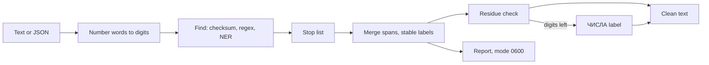

# pii-scrub

Replace personal data in Russian text with stable labels, including phone numbers and e-mails spoken as words.

[](https://github.com/daniil4545/pii-scrub/actions/workflows/ci.yml)
[](https://github.com/daniil4545/pii-scrub/releases)
[](LICENSE)


Built for call transcripts: a speech recognizer writes "восемь девятьсот двенадцать триста сорок пять" instead of digits, and most PII tools stop at digits. Labels are in Russian (`[ИМЯ_1]`, `[ТЕЛЕФОН_1]`), because the text is.

Status: version 0.2, tested on generated text and on a small set of real call transcripts (not published). See [Evaluation](#evaluation) and [Limitations](#limitations).

## Features

| What | How |
|---|---|
| Names, places, organizations | [Natasha](https://github.com/natasha/natasha) NER; a morphology filter and a stop list keep verbs and roles (МОП, ЛПР) unmasked |
| Phone numbers | digits, digit words, grouped words, pieces mixed with digits, dictation interrupted by replies ("так", "да") |
| INN, OGRN, bank cards, SNILS | checksum validators, digits or words |
| Accounts, passports, nicknames, sites | regular expressions |
| E-mail | `a@b.ru` and "иван точка петров собака мэйл точка ру" |
| Address, birth date | street with house and flat; a date after "родился" |
| Stable labels | one person gets one label in every case form: "Ивану Сергеевичу" and "Иван Сергеевич" are `[ИМЯ_1]` |
| No residue | 7 or more digits left after masking (outside an amount with a currency) and pieces of a dictated number near it become `[ЧИСЛА_N]` |
| Call context | a name addressed at the start of a phrase, a street without "улица" before a house number, a postcode near a city, a client name after "называется" or "компания" |
| Brands and terms kept | equipment brands and radio terms from `data/terms.txt` and your own words (`--keep`) stay unmasked |
| Text or JSON input | JSON keeps its structure, only string values are cleaned |
| Report | originals go to a separate file with mode 0600, never to the output or stderr |

## Install

Needs [uv](https://docs.astral.sh/uv/); it fetches Python 3.13 itself.

```sh
uv tool install git+https://github.com/daniil4545/pii-scrub@v0.2.0
```

From a clone, for development: `git clone https://github.com/daniil4545/pii-scrub && cd pii-scrub && uv sync`, then `uv run scrub`.

## Quick start

1. Save this text as `demo.txt`:

```text
Менеджер: Назовите ваш телефон.
Клиент: Меня зовут Иван Петров, восемь девятьсот двенадцать триста сорок пять шестьдесят семь восемьдесят девять.
Клиент: Почта иван точка петров собака мэйл точка ру.
```

2. Clean it. The summary goes to stderr, the text to the file:

```console
$ scrub demo.txt -o demo.clean.txt
scrub: 3 replacements (ИМЯ 1, ТЕЛЕФОН 1, EMAIL 1)
$ cat demo.clean.txt
Менеджер: Назовите ваш телефон.
Клиент: Меня зовут [ИМЯ_1], [ТЕЛЕФОН_1].
Клиент: Почта [EMAIL_1].
```

3. When digits are left that no rule recognizes, the tool masks them instead of passing them on. `Менеджер: Код 123 45 67 сохраните.` in `demo2.txt` gives:

```console
$ scrub demo2.txt -o demo2.clean.txt && cat demo2.clean.txt
scrub: 1 replacements (ЧИСЛА 1)
Менеджер: Код [ЧИСЛА_1] сохраните.
```

Without `-o` the result goes to stdout, without a file name the input is read from stdin. `--report FILE` writes the originals to a separate file (mode 0600). `--keep FILE` takes words that are never masked, such as your own company name: one word per line, `*` marks a stem.

Exit codes: 0 done; 1 internal error or NER failure; 2 input or write error (not UTF-8, broken JSON, input over 1 MB). Exit code 3 (refusal on residue) was removed in 0.2.0: residue is masked.

## Library

```python
from pii_scrub.scrub import Scrubber, ScrubRefused, load_natasha, parse_terms

load_natasha()  # once per process: loads the Natasha models
keep = parse_terms("acme*")  # words that are never masked, e.g. your own company
try:
    clean = Scrubber(keep=keep).scrub(text)  # a new Scrubber for every file
except ScrubRefused as refused:
    ...  # input too large or invalid; refused.reason carries no input text
```

## How it works



Number words become digits only for searching. A match is mapped back to whole original words, so the mask always covers what was said. Three projections cover the ambiguity of speech: "двести семьдесят девять" is 279 or 200 and 79.

## Evaluation

`make eval` runs a frozen synthetic set generated from a seed: 240 texts with personal data, 80 without, and one long call (57 thousand characters). Every fifth text is held back from debugging.

| Measure | Result | Limit |
|---|---|---|
| Missed phone, INN, e-mail (words, digits, pieces, across replies) | 0 | 0 |
| Texts without personal data that got a mask or a refusal | 7 of 80 | 10% |
| Refusals on texts with personal data | 0 of 241 | 5% |
| Missed names / places / organizations | 2 of 228 / 0 of 84 / 2 of 62 | reported |
| Missed addresses / birth dates | 2 of 77 / 0 of 37 | reported |

A long call of 98 KB is cleaned in 0.3 s on a laptop CPU.

The set is written by the author of the rules, so it proves consistency, not coverage of real speech. It was extended after an independent code review found forms the first set did not contain. Held-out discipline was not perfect: the long text and some diagnostics read the whole set. Order numbers (1 text in 16) and quantity confirmations (1 in 40) in the negative set are the author's guess of their frequency.

## Privacy

| Promise | Checked by |
|---|---|
| Originals appear only in the report file, which has mode 0600 | `test_report_holds_originals_with_0600_and_outputs_do_not` |
| Every detected kind is masked in the output and in stderr | `test_acceptance_every_kind_masked_in_output_and_stderr` |
| Residue is masked and its original goes only to the report | `test_residue_masked_with_exit_0_and_original_in_report` |
| An input error or an unexpected failure writes no output | `test_input_errors_exit_2_and_write_nothing`, `test_unexpected_error_exits_1_with_kind_but_without_input_text` |
| The evaluator fails on a tool that masks nothing, everything, or refuses everything | `test_doing_nothing_fails_on_blocking_classes`, `test_masking_everything_fails_on_the_negative_set`, `test_refusing_everything_fails_on_both_limits` |
| The tests run with the network closed | `--block-network` in `make commit-check` |

## Limitations

- Not validated on real calls yet.
- A number dictated with anything but short confirmations ("так", "да", "угу", "значит") between the pieces is not joined; pieces under 7 digits pass.
- A bare number of 7 or more digits (an order number), and a number without a unit within 3 lines of a phone or the word "ИНН", become `[ЧИСЛА_N]`: the model does not see them.
- A capitalized common noun at the start of a line is sometimes taken for an organization by the NER model.
- A street in lower case is not found; JSON keys are not cleaned and appear in the refusal message.
- Names in lower case were not tested.
- Not detected: car plates, VIN, driver's licence, health insurance number, contract numbers, special categories (health, nationality, religion).
- Labels are numbered per file: the same person in two files gets different numbers.

## Development

```sh
make commit-check   # format, lint, fast tests
make eval           # synthetic evaluation
make ci-check       # plus pip-audit and gitleaks
```

## License

MIT, see [LICENSE](LICENSE).
